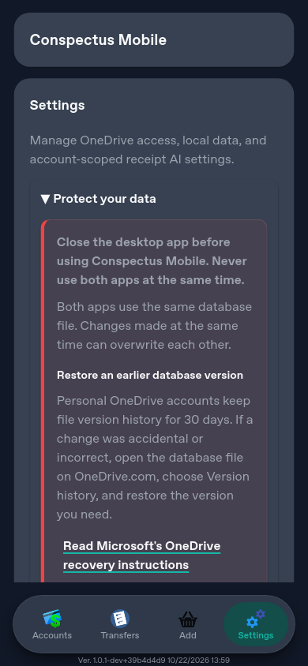
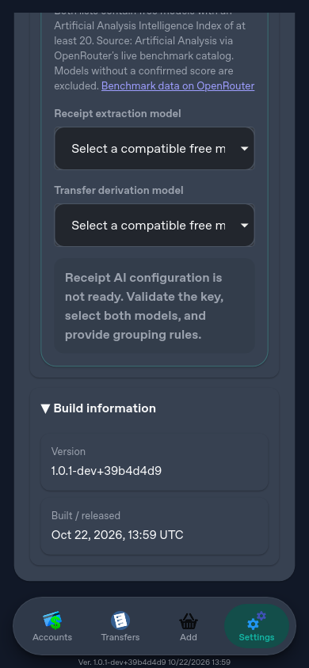
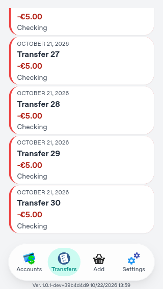

# App shell layout verification — 2026-10-22

The primary navigation now uses the bottom edge more efficiently. Build metadata stays below the
navigation on every route, including startup loading, and the app title scrolls with the page.
The native bottom safe area is preserved for devices with a home indicator.

## Coverage

- Settings and a list of 30 transfers: scroll the title out of view while keeping navigation and
  build metadata stationary; the final content remains reachable above the navigation.
- Route changes: return the scroll position to the top and show the title again.
- Viewports: 320 × 568, 390 × 844, 844 × 390, and 1280 × 800; light and dark appearance.
- Geometry: no horizontal page overflow, a compact footer below navigation, and a 2px minimum
  bottom gap when the device reports no safe-area inset.
- Build identity: the footer uses running-build metadata even if newer server metadata exists.

## Verification

- `npm run check:local`: formatting, lint, type checking, dead-code analysis, 942 passing unit and
  integration tests (2 opt-in tests skipped), production build, and bundle budgets passed.
- Full Safari/WebKit suite with one worker: 132 passed, 5 platform-specific skips, before the final
  Main refresh.
- After integrating Main `39b4d4d`: all 45 focused browser checks passed across Chromium, Pixel 5,
  and iPhone WebKit. This includes every transfer-editor test, four viewport sizes, and scrolling
  a database browser containing 81 files. Screenshots below come from this final run.
- Earlier parallel execution exposed an incorrect scroll-test starting position and Safari
  timeouts on the two-core executor. The scroll test now explicitly starts at the top after
  browser actions that scroll automatically. Safari was rerun with one worker; no retries or
  increased timeouts were introduced.

Browser tests use the existing synthetic auth, Graph, cache, and database harness. They do not
exercise a live Microsoft/OneDrive account, live receipt AI, or a physical iOS/Android device.
Browser emulation does not verify a physical home indicator's safe-area inset.

## Screenshots

Captured by `tests/e2e/persistent-shell.spec.ts` after transient toasts disappear.

Settings before scrolling (390px, dark):

Settings after scrolling (390px, dark):

End of the transfer list (320px, light):

